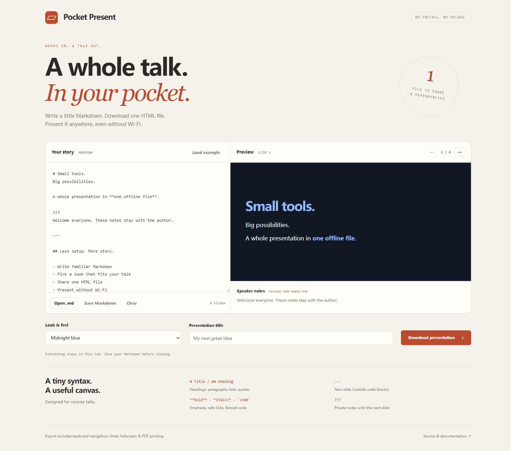

# Pocket Present

**Markdown 写演示，导出一个 HTML 文件，离线打开即可讲。**

[在线体验](https://Chanson4.github.io/pocket-present/) · [离线下载](https://github.com/Chanson4/pocket-present/releases/latest) · [English](README.md)



无需账号、构建或安装。打开页面，加载示例，编辑内容，选主题，然后下载 `presentation.html`。该文件包含完整演示样式和操作功能，可直接分享，在没有网络的浏览器中打开。

支持三种主题、实时预览、键盘翻页、全屏、可暂停计时器、黑屏和打印为 PDF。

```markdown
# 我的分享

一个值得讲清楚的想法。

???
这里是私人讲稿备注，不会进入导出的 HTML。

---

## 三个重点

- **问题**是什么
- *方案*怎么做
- 为什么值得试试
```

- `---`：分隔幻灯片，代码块内不会分割。
- `???`：开始作者备注，到下一张幻灯片结束。
- 支持一至三级标题、段落、扁平列表、引用、行内代码、代码块、粗体、斜体和安全链接。
- 原始 HTML 作为文本显示。暂不支持嵌套格式、表格、图片、图表、视频和语法高亮。

导出演示后使用方向键、Page Up/Down、Home/End 翻页，`B` 切换黑屏，点击即可退出黑屏。计时按钮用于开始、暂停和继续。

打印 PDF 时选择横向，开启背景图形，关闭浏览器页眉页脚。简短幻灯片每张一页；过长内容可能跨页。

内容不上传，不写入浏览器存储。关闭前请点击“Save Markdown”；这份 Markdown **包含作者备注**，导出的 HTML **不包含备注**。导入文件或加载示例会替换当前内容。导入文件上限为 512 KB，建议短内容。

```sh
node --test
```

测试需要 Node 20+，应用本身零依赖。更多细节见 [完整说明](README.md) 与 [贡献指南](CONTRIBUTING.md)。
